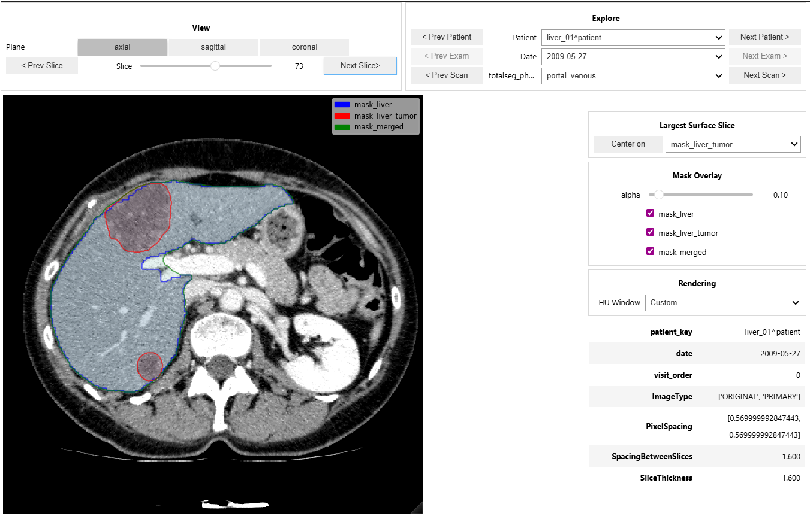

<p align="center">
  
</p>

<p align="center">
  <a href="https://pypi.org/project/imperandi/"></a>
  <a href="https://pypistats.com/packages/imperandi"></a>
  
  <a href="https://imperandi.readthedocs.io/en/latest/"></a>
  <a href="https://github.com/dmandache/IMPERANDI/actions/workflows/tests.yml"></a>
  <a href="https://app.codecov.io/github/dmandache/IMPERANDI"></a>
  
  
</p>

IMPERANDI (**IMaging PREprocessing And Normalization for Diagnostic
Interoperability**) is a Python framework and command-line interface for turning
heterogeneous DICOM collections into traceable, analysis-ready CT and MR imaging
cohorts. It discovers images, standardizes identifiers, curates series and
volume-level metadata, and connects NIfTI conversion, segmentation, contrast-phase
resolution, organ registration, radiomics, and interactive quality control.

Each stage reads and writes a CSV cohort table linked to images and masks on disk.
You can stop after metadata curation or conversion, run the full pipeline, or use
individual stages in an existing research workflow. The built-in `generic`
manifest provides CT/MR curation and liver-focused processing; YAML manifests
adapt the workflow to a dataset's identifiers, selection rules, and processing
tasks.

[Documentation](https://imperandi.readthedocs.io/en/latest/) ·
[Installation](#installation) · [Quickstart](#quickstart) ·
[Configuration](#configuration) · [Outputs](#outputs-and-cohort-selection) ·
[Contributing](#development-and-contributing)

## Google Colab demos

Try IMPERANDI on three public TCGA-LIHC patients:

| Demo | Workflow | Launch |
| --- | --- | --- |
| [Light demo](examples/demos/demo_light.ipynb) | DICOM ingestion, metadata phase curation, and QC. | [](https://colab.research.google.com/github/dmandache/IMPERANDI/blob/main/examples/demos/demo_light.ipynb) |
| [Full demo](examples/demos/demo_full.ipynb) | Adds NIfTI conversion, liver segmentation, radiomics, the interactive viewer and TorchIO preprocessing into a PyTorch batch. | [](https://colab.research.google.com/github/dmandache/IMPERANDI/blob/main/examples/demos/demo_full.ipynb) |

## What IMPERANDI does

| Stage | Purpose | Main result |
| --- | --- | --- |
| `parse` | Discover DICOM folders and ZIP/TAR archives, extract headers, and derive patient/study/series identifiers. | Instance-level DICOM index. |
| `clean` | Group instances into volumes, normalize dates and acquisition order, filter unsuitable images, and curate CT/MR sequences and phases. | Volume-level cohort and optional representative-series selection. |
| `ingest` | Run `parse` followed by `clean`. | Parsed and cleaned indexes in one workflow. |
| `convert` | Convert curated volumes with dicom2nifti while preserving source references. | NIfTI images and `nifti_path` columns. |
| `segment` | Run modality-specific TotalSegmentator tasks and optional logical/morphological mask operations. | `mask_<output>_path` columns and NIfTI masks. |
| `phase` | Resolve canonical contrast phase through ordered rules, ontology mappings, and optional model predictions. | Phase labels, provenance, selection, and QC tables. |
| `register` | Align organs within configured groups and optionally combine masks in native or common-reference space. | Registered/consensus masks, original paths, and registration QC. |
| `radiomics` | Extract PyRadiomics features using modality-specific settings and cohort filters. | ROI-prefixed feature columns. |
| QC viewers | Browse images and mask overlays in Jupyter or a browser. | Interactive review of the cohort. |

```text
DICOM folders / archives
          |
     parse + clean (ingest)
          |
     volume-level CSV -----> selected cohort + QC reports
          |
        convert ----------> NIfTI images
          |
        segment ----------> masks
          |
         phase -----------> phase provenance + refreshed selection
          |
        register ---------> organ alignment + tumor consensus 
          |
        radiomics --------> feature table
```

Phase resolution can also run before segmentation. Radiomics needs image and
mask paths, plus a `phase` column when phase-based filtering is configured.
Long-running stages support checkpoints and resume, with per-volume failures
recorded separately. See the [workflow guide](docs/source/workflow.md) for stage
dependencies and cohort selection.

## Installation

Requires **Python 3.10–3.13**. Create an isolated environment and install the base
package for DICOM ingest and NIfTI conversion:

```bash
python -m venv .venv
source .venv/bin/activate
python -m pip install --upgrade pip
python -m pip install imperandi
imperandi --help
```

On Windows PowerShell, activate with `.venv\Scripts\Activate.ps1`. The multiline
shell examples below use Bash continuation syntax; in PowerShell, enter each
command on one line or use PowerShell's backtick continuation.
`python -m imperandi` is equivalent to the `imperandi` entry point.

### Optional features

Install the features your workflow needs into the same environment:

| Feature | Install command |
| --- | --- |
| Segmentation and image-based phase prediction | `python -m pip install "imperandi[segment]"` |
| Organ registration with SimpleITK | `python -m pip install "imperandi[registration]"` |
| Notebook and browser QC viewers | `python -m pip install "imperandi[viewer]"` |
| All packaged runtime extras, including registration dependencies | `python -m pip install "imperandi[all]"` |
| Test, lint, and formatting tools | `python -m pip install "imperandi[dev]"` |
| Public-dataset test downloader | `python -m pip install "imperandi[slow]"` |
| Runtime, development, and dataset-test dependencies | `python -m pip install "imperandi[all-dev]"` |

**PyRadiomics is installed separately**, including when using `all` or `all-dev`.
The project's installation workflow uses Git and requires Git to be available:

```bash
python -m pip install "pyradiomics @ git+https://github.com/AIM-Harvard/pyradiomics.git@master"
```

TotalSegmentator may download model weights on first use. Allow network access
and storage for those downloads, and start with a small cohort to size memory
and worker requirements. Installation details are in the
[installation guide](docs/source/installation.md).

### Install from source

With your virtual environment activated:

```bash
git clone https://github.com/dmandache/IMPERANDI.git
cd IMPERANDI
python -m pip install -e .
```

For editable installs with extras, use commands such as
`python -m pip install -e ".[segment,viewer]"` or
`python -m pip install -e ".[all-dev]"`.

## Quickstart

Keep source DICOMs, cohort tables, and generated images in separate directories:

```text
project/
├── dicom/          # source DICOM collection
├── tables/         # cohort indexes, error reports, and QC tables
├── nifti/          # converted images and segmentation outputs
└── registration/   # optional registration artifacts
```

Run these examples from the directory containing `project/`. Use the base
installation for steps 1–2, the `segment` extra for steps 3–4, the `registration`
extra for step 5, and the separate PyRadiomics installation for step 6.

### 1. Inspect and ingest DICOM metadata

All pipeline commands accept `--dry-run` to inspect their plan and resolved
settings before processing:

```bash
imperandi ingest \
  --root_path ./project/dicom \
  --output_dir ./project/tables \
  --manifest generic \
  --dry-run
```

Then run ingestion:

```bash
imperandi ingest \
  --root_path ./project/dicom \
  --output_dir ./project/tables \
  --manifest generic
```

This writes `dicom_index.csv` and `dicom_index_clean.csv`, plus selection and QC
reports. The cleaned table has one row per retained reconstructed volume. Add
`--snapshot_tags` to export a sampled DICOM-tag snapshot for metadata inspection.

### 2. Convert volumes to NIfTI

```bash
imperandi convert \
  --csv_path ./project/tables/dicom_index_clean.csv \
  --output_dir ./project/nifti \
  --csv_path_out ./project/tables/nifti_index.csv
```

Successful rows receive `nifti_path`; failed conversions are reported in
`conv_errors.csv`. This example processes the full cleaned cohort. To process
representative volumes instead, use `dicom_index_curated.csv` as input; see
[cohort selection](#outputs-and-cohort-selection).

### 3. Segment images

```bash
imperandi segment \
  --csv_path ./project/tables/nifti_index.csv \
  --csv_path_out ./project/tables/nifti_index_segmented.csv \
  --manifest generic \
  --num_workers 1
```

The built-in manifest runs liver and liver-lesion tasks for CT and their MR
counterparts for MR/MRI, producing `mask_liver_path` and
`mask_liver_tumor_path`. Starting with one worker limits simultaneous model and
image memory use; increase it after validating a small run.

Optional `--crop --crop-margin-mm 50` crops the source NIfTI and all output masks
**in place** to a shared foreground bounding box before mask post-processing.
It retains only existing voxels within the image bounds. Cropping is disabled
in the built-in manifest.

### 4. Resolve contrast phases

```bash
imperandi phase \
  --csv_path ./project/tables/nifti_index_segmented.csv \
  --csv_path_out ./project/tables/nifti_index_phased.csv \
  --manifest generic
```

The built-in strategy tries metadata rules first, then TotalSegmentator for
unresolved **CT** rows. MR phase curation uses metadata; the built-in image-based
predictor is CT-only. Outputs include canonical `phase`, provenance such as
`phase_source` and `phase_reason`, and refreshed selection/QC tables.

Metadata curation also runs during generic ingestion. If you only need that
result, you can stop after ingest without installing a prediction backend.

### 5. Optionally register organs and masks

```bash
imperandi register \
  --csv_path ./project/tables/nifti_index_phased.csv \
  --csv_path_out ./project/tables/nifti_index_registered.csv \
  --output_dir ./project/registration \
  --manifest generic
```

The built-in manifest groups scans by patient, study, and modality and publishes
masks on each scan's native grid (`output_space: moving`). For successful rows,
canonical mask paths point to the consensus results; original paths remain in
`source_*` columns. Review `register_qc.csv` and status fields before downstream
analysis. See [registration](docs/source/registration.md) for common-reference
output, alignment stages, and options to retain individual segmentations.

### 6. Extract radiomics

For the workflow without registration:

```bash
imperandi radiomics \
  --csv_path ./project/tables/nifti_index_phased.csv \
  --csv_path_out ./project/tables/nifti_index_radiomics.csv \
  --manifest generic
```

If you ran step 5, use `nifti_index_registered.csv` as the input to extract from
its masks. Radiomics discovers populated `mask_*_path` columns and applies the
manifest's CT or MR settings.

**The `generic` manifest retains only `ARTERIAL` and `PORTAL_VENOUS` rows for
radiomics.** Other phases are excluded from the output. Edit `radiomics.filters`
in a custom manifest, or pass `--skip_filter` to disable both manifest and CLI
filters. A CLI `--filter` does not override a manifest filter for the same column.

## Configuration

Pass `--manifest generic` for the bundled baseline or
`--manifest ./site-a.yaml` for your own YAML file. JSON manifests are not accepted.
Start from the [built-in manifest](src/imperandi/builtin_datasets_config/manifests/generic.yaml)
or the [annotated blueprint](examples/blueprint_manifest_example.yaml).

To copy the installed baseline without a source checkout, run this in Python:

```python
from importlib.resources import files
from pathlib import Path

baseline = files("imperandi.builtin_datasets_config").joinpath(
    "manifests", "generic.yaml"
)
Path("site-a.yaml").write_text(baseline.read_text(encoding="utf-8"), encoding="utf-8")
```

Edit the copy, then use it consistently across the stages that accept a manifest:

```bash
imperandi ingest \
  --root_path ./project/dicom \
  --output_dir ./project/tables \
  --manifest ./site-a.yaml \
  --dry-run
```

| Manifest section | Controls |
| --- | --- |
| `id_extraction` | Identifier source (`auto`, `tags`, or `path`), DICOM tag names, and path fallback. |
| `id_standardization`, `derived_columns` | Python hooks for dataset-specific identifiers and metadata. |
| `cleaning.steps` | Ordered filtering, volume grouping, acquisition ordering, modality curation, and phase curation. |
| `phase_curation` | Strategy precedence, canonical phase mappings, unresolved fallback, and selection groups. |
| `segmentation.modalities` | CT/MR tasks, output names, and optional mask post-processing. |
| `registration` | Grouping, organ/tumor mask columns, alignment stages, consensus, and output space. |
| `radiomics` | CT/MR PyRadiomics parameters and cohort filters. |

Review these baseline choices when adapting to a new dataset:

- `generic` derives `patient_key` from **PatientName**, with path fallback; change
  `id_extraction.patient_key.from_tag` if your cohort uses PatientID or another tag.
- Cleaning includes geometry and acquisition filters, including a reconstructed
  volume-length range of 30–1700 mm. Inspect these rules for your protocols.
- Cleaning steps execute in order. Modality curation produces evidence; the
  subsequent phase-curation step resolves canonical phases and selection.
- Segmentation tasks are liver-focused, and radiomics settings differ for CT and
  MR. The CT configuration includes an HU resegmentation range; MR omits it.
- Manifest radiomics parameters take precedence over `--pyradiomics_settings`,
  and manifest filters take precedence over CLI filters for the same column.

The [configuration guide](docs/source/manifests.md) explains hooks, phase rules,
selection ranking, mask operations, and validation. Repository-specific OPERANDI
settings in [dataset_configs/](dataset_configs/README.md) are loaded by explicit
YAML path and are not installed with the package.

## Outputs and cohort selection

The main cohort table preserves source identifiers and accumulates artifact paths
and results. Core columns include `patient_key`, `study_id`, `series_id`,
`dicom_path`, `nifti_path`, `mask_<output>_path`, and canonical `phase` provenance.
`dicom_path` may represent multiple instances or archive members; do not assume
it is one ordinary file path.

| Stage | Default main table | Error or QC reports |
| --- | --- | --- |
| `parse` | `dicom_index.csv` | `dicom_index_errors.csv`; optional `dicom_tags_snapshot.ndjson`. |
| `clean` / `ingest` | `<input_stem>_clean.csv` / `dicom_index_clean.csv` | Selection and phase QC exports when configured. |
| `convert` | `nifti_index.csv` | `conv_errors.csv`. |
| `segment` | Input CSV, unless `--csv_path_out` is supplied | `seg_errors.csv`; warnings when applicable. |
| `phase` | Input CSV, unless `--csv_path_out` is supplied | `phase_errors.csv`; selection and phase QC exports. |
| `register` | `<input_stem>_registered.csv` | `register_errors.csv`, `register_qc.csv`, and per-group logs. |
| `radiomics` | `<input_stem>_radiomics.csv` | `radiomics_errors.csv`. |

The quickstart gives every stage a distinct output CSV. Check error reports,
missing image/mask paths, and input/output row counts: a command can finish
successfully even when individual volumes fail.

Phase curation writes three additional reports:

- **`<input_stem>_curated.csv`** contains the best eligible CT volume per phase
  or MR volume per sequence/phase slot in each exam. Use this table as pipeline
  input when you want representative volumes.
- **`qc_<input_stem>_curated.csv`** is a wide review table with selection scores
  and provenance. It is intended for QC rather than downstream processing.
- **`qc_unresolved_phase.csv`** retains cases unresolved before fallback, with
  their rule/model evidence for inspection.

Selection does not reduce the main cleaned or phased table. Use the full table
to process all candidates, and select a table with the image/mask paths required
by the next stage.

Selection filenames derive from the **input CSV**, even when `--csv_path_out`
names another location. Ingest therefore produces `dicom_index_curated.csv`;
quickstart step 4 produces `nifti_index_segmented_curated.csv`. Only `phase`
offers `--selected_csv_path` to override that location. Subsequent exports replace
selection/QC files, so use separate directories for reports you want to retain.
See the [output reference](docs/source/outputs.md) for path conventions and
registration provenance.

## Resuming, retries, and logging

`parse`, `convert`, `segment`, `phase`, `register`, and `radiomics` checkpoint long
runs and resume compatible work by default. The parse stage of `ingest` also uses
these controls. Repeat the original command with the same paths and settings to
resume after interruption.

| Option | Behavior |
| --- | --- |
| `--checkpoint_every_rows N` | Flush checkpoint files after N processed rows. |
| `--checkpoint_every_sec T` | Flush checkpoint files after T seconds. |
| `--no_resume` | Ignore matching checkpoint state and start a fresh run. |
| `--strict_resume` | Use content hashing for stronger input-change detection. |
| `--retry_failed` | Retry recorded failures while preserving successful work; available for `convert`, `segment`, `phase`, `register`, and `radiomics`. |

Normal resume retains recorded failures. After fixing their cause, rerun the
original command with `--retry_failed`, for example:

```bash
imperandi convert \
  --csv_path ./project/tables/dicom_index_clean.csv \
  --output_dir ./project/nifti \
  --csv_path_out ./project/tables/nifti_index.csv \
  --retry_failed
```

Relevant input or configuration changes can invalidate cached work. Default
fingerprints do not detect every change to image contents at the same path; use
`--strict_resume` when content verification is needed. More detail is in
[checkpoints and resume](docs/source/workflow.md#checkpoints-and-resume).

Global logging options go **before** the subcommand:

```bash
imperandi --log-level DEBUG --log-file imperandi-debug.log ingest \
  --root_path ./project/dicom \
  --output_dir ./project/tables \
  --manifest generic
```

Use `imperandi COMMAND --help` for the options supported by your installed
version, and the [CLI reference](docs/source/cli.md) for command behavior.

## Quality control



Explore patients, exams, and contrast phases while reviewing image slices and
segmentation overlays with adjustable display settings.

Install `imperandi[viewer]` and open a cohort table with readable `nifti_path`
values. Optional `mask_*_path` columns provide overlays. In a Jupyter notebook:

```python
%matplotlib widget

import pandas as pd
from imperandi.qc.viewer import ScanViewer

cohort = pd.read_csv("./project/tables/nifti_index_phased.csv")
viewer = ScanViewer(cohort, ct_scan_col="nifti_path", phase_col="phase")
```

Constructing `ScanViewer` displays its controls and discovers mask path columns
automatically. Despite the `ct_scan_col` name, the viewer supports both CT and MR.
For registered outputs, load `nifti_index_registered.csv` instead.

For the browser viewer, run from a source checkout with the viewer extra installed:

```bash
panel serve src/imperandi/qc/viewer_web.py --show --args \
  --csv ./project/tables/nifti_index_phased.csv \
  --scan-col nifti_path \
  --phase-col phase
```

Images must be accessible to the notebook or viewer server; uploading a CSV does
not upload its referenced images. See the [viewer guide](docs/source/viewers.md)
for PyPI-only installations and display options. The [dashboards/](dashboards/)
notebooks also explore DICOM-tag snapshots and radiomics statistics.

## Troubleshooting

| Symptom | First checks |
| --- | --- |
| Missing optional dependency | Install the matching extra or PyRadiomics in the environment running `python -m imperandi`. |
| No DICOM files or unexpected identifiers | Check input paths, archive depth, and `id_extraction`; inspect a `--snapshot_tags` sample. |
| Cleaning removes expected volumes | Inspect parsed metadata and `cleaning.steps`, including orientation, spacing, thickness, and volume length. |
| Conversion fails for archive members | Keep source archives at their indexed paths; check cache permissions, disk space, and `conv_errors.csv`. |
| Failed rows are skipped on resume | Repeat the original command with `--retry_failed` after resolving the errors. |
| Radiomics output has fewer rows | Check `radiomics.filters`; the generic manifest includes only arterial and portal-venous phases. |
| Workers hang or memory is exhausted | Reduce `--num_workers`; keep segmentation's default `spawn` start method while diagnosing. |

The [troubleshooting guide](docs/source/troubleshooting.md) covers these cases in
more detail. To report an issue, include your version, command, manifest settings,
and relevant error report as described in [CONTRIBUTING.md](CONTRIBUTING.md).

## Repository layout and further examples

| Path | Contents |
| --- | --- |
| [src/imperandi/](src/imperandi/) | CLI and Python modules for ingest, curation, processing, extraction, QC, and shared utilities. |
| [src/imperandi/builtin_datasets_config/](src/imperandi/builtin_datasets_config/) | Manifests and hooks shipped with the package. |
| [dataset_configs/](dataset_configs/README.md) | Repository-local OPERANDI manifest and hooks. |
| [examples/](examples/README.md) | Manifest blueprint, Colab demos, and public-data benchmarks. |
| [dashboards/](dashboards/) | Interactive viewer and exploratory analysis notebooks. |
| [docs/source/](docs/source/index.rst) | User guides and Python API documentation. |
| [tests/unit/](tests/unit/) | Fast, isolated tests. |
| [tests/slow/](tests/slow/README.md) | Optional dataset-backed pipeline validation. |

For reproducible public-data workflows, see the
[TCGA-LIHC MRI and CT benchmarks](examples/benchmarks/README.md),
[IRCAD pipeline](tests/slow/ircad/README.md), and
[TCGA-LIHC pipeline tests](tests/slow/tcga_lihc/README.md). Benchmark runners include
Bash, PowerShell, and Slurm entry points. The
[workflow guide](docs/source/workflow.md#example-slurm-batch-script) also includes
an example full-pipeline Slurm job.

## Development and contributing

From a source checkout with your virtual environment activated:

```bash
python -m pip install -e ".[all-dev]"
python -m pip install "pyradiomics @ git+https://github.com/AIM-Harvard/pyradiomics.git@master"
python -m ruff check .
python -m pytest -m "not slow"
```

CI runs lint and fast tests on Python 3.10–3.13, with a 70% coverage minimum.
Dataset-backed tests require prepared data and optional dependencies; follow
[their setup guide](tests/slow/README.md) before running them.

To build the documentation:

```bash
python -m pip install -r docs/requirements.txt
sphinx-build -W --keep-going -b html docs/source docs/build/html
```

Open `docs/build/html/index.html`. See [CONTRIBUTING.md](CONTRIBUTING.md) for
development conventions, notebook output cleanup, bug reports, and pull requests.
Contributions to documentation, reproducible examples, and CT/MR curation rules
are welcome.

## License

IMPERANDI is distributed under the [Apache License 2.0](LICENSE).

## Disclaimers

### Research use only

IMPERANDI is research software and is not a medical device. Outputs are not intended for clinical diagnosis or treatment decisions without independent validation.

### DICOM privacy

IMPERANDI should not be assumed to de-identify input DICOM data. Users are responsible for appropriate anonymization and data-governance procedures before processing or sharing data.

### Funding

This work performed under the RHU OPERANDI project was supported in part by the French National Research Agency (Agence Nationale de la Recherche, ANR) as its 3rd PIA, integrated to France 2030 plan under reference _ANR-21-RHUS-0012._
